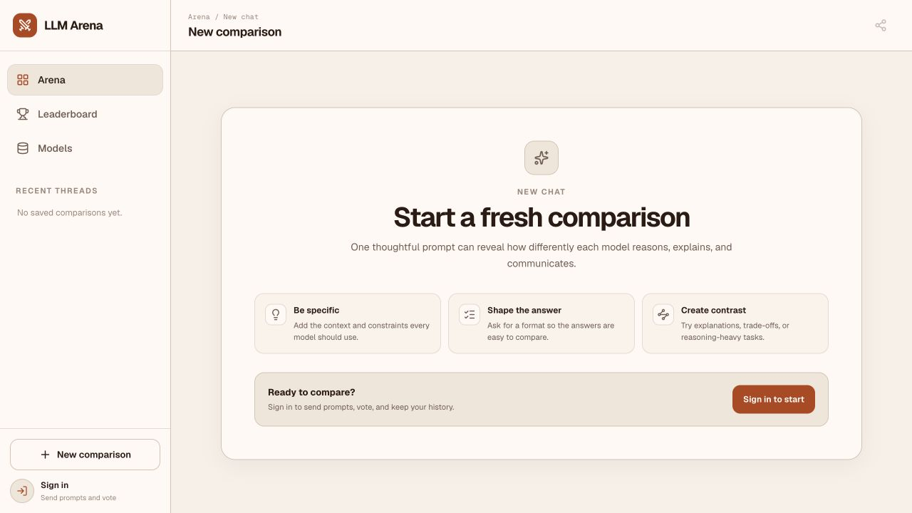
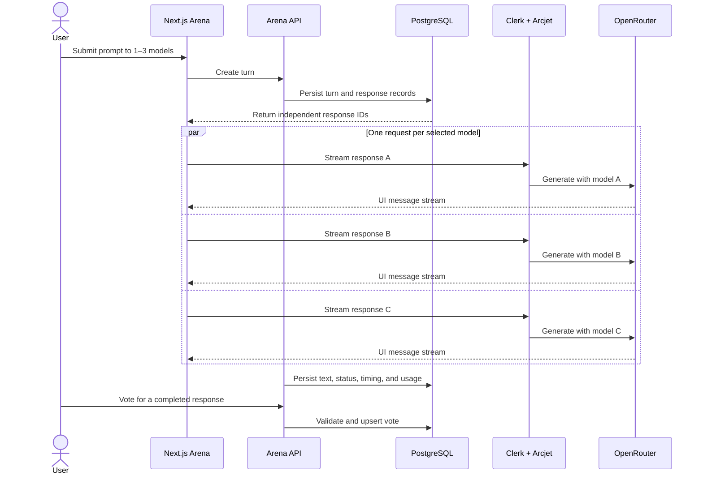

# LLM Arena

Compare up to three free AI models side by side, watch every answer stream independently, and turn real head-to-head votes into a transparent leaderboard.

[](https://nextjs.org/)
[](https://www.typescriptlang.org/)
[](https://www.prisma.io/)
[](https://nodejs.org/)



LLM Arena is an evaluation workspace for comparing real model behavior—not a synthetic benchmark. A prompt is sent to one, two, or three free-tier models through OpenRouter. Each model receives its own request, stream, retry path, conversation history, and performance measurements, so a slow or failed provider never blocks the others.

## Why it is useful

- **Independent parallel streams** — every model call can complete, fail, retry, or be cancelled without affecting its peers.
- **Measured responses** — each completed answer records time to first token, output speed, and token usage.
- **Real voting** — votes are backed by database constraints and can only select a completed response from a turn with at least two completed answers.
- **Honest rankings** — global and personal leaderboards use actual wins and comparisons instead of an opaque score.
- **Model continuity** — follow-up prompts reconstruct a separate server-owned conversation for each model.
- **Live free-model catalog** — eligible OpenRouter models are filtered to free text-in/text-out options, cached for five minutes, and sorted by context window.
- **Shareable results** — saved comparison links are publicly readable while prompts, retries, and votes remain owner-only.
- **Production-minded controls** — Clerk authentication, Arcjet protection, PostHog product analytics, and PostHog LLM tracing are integrated at the request boundary.

## How it works



The browser fans out one HTTP request per selected model. Before generation begins, the server authenticates the owner, atomically claims the response attempt, applies Arcjet controls, reconstructs that model's prior conversation from the database, and starts a Vercel AI SDK stream through OpenRouter. Completion metrics are persisted server-side rather than trusted from the client.

## Product surfaces

| Surface       | Purpose                                                                     | Access                                            |
| ------------- | --------------------------------------------------------------------------- | ------------------------------------------------- |
| Arena         | Run comparisons, continue threads, retry individual failures, and vote      | Public landing page; sign-in required to interact |
| Shared thread | Read a saved comparison at `/?thread=<id>`                                  | Public, read-only for non-owners                  |
| Leaderboard   | Compare global and personal win records, TTFT, and output speed             | Signed in                                         |
| Models        | Search the current free OpenRouter catalog and inspect capabilities/context | Signed in                                         |

## Tech stack

| Layer          | Technology                                                                |
| -------------- | ------------------------------------------------------------------------- |
| Framework      | Next.js 16 App Router, React 19, TypeScript                               |
| UI             | Tailwind CSS 4, shadcn/ui, Radix UI, Lucide, Streamdown                   |
| AI             | Vercel AI SDK 6, OpenRouter AI SDK provider                               |
| Data           | PostgreSQL, Prisma 7 with the `pg` driver adapter                         |
| Authentication | Clerk                                                                     |
| Security       | Arcjet Shield, bot detection, prompt-injection detection, and rate limits |
| Analytics      | PostHog product analytics, session replay, heatmaps, and LLM tracing      |

## Getting started

### Prerequisites

- Node.js 20.9 or newer
- npm
- A PostgreSQL database
- Clerk, OpenRouter, Arcjet, and PostHog projects

### 1. Clone and install

```bash
git clone https://github.com/Muqeetullah/llm-arena.git
cd llm-arena
npm install
```

`npm install` also configures the repository's pre-commit hook.

### 2. Configure the environment

```bash
cp .env.example .env.local
```

Fill in the following values:

| Variable                                          | Description                                             |
| ------------------------------------------------- | ------------------------------------------------------- |
| `NEXT_PUBLIC_CLERK_PUBLISHABLE_KEY`               | Clerk frontend publishable key                          |
| `CLERK_SECRET_KEY`                                | Clerk server secret                                     |
| `NEXT_PUBLIC_CLERK_SIGN_IN_URL`                   | Local sign-in route; normally `/sign-in`                |
| `NEXT_PUBLIC_CLERK_SIGN_UP_URL`                   | Local sign-up route; normally `/sign-up`                |
| `NEXT_PUBLIC_CLERK_SIGN_IN_FALLBACK_REDIRECT_URL` | Post-sign-in fallback; normally `/`                     |
| `NEXT_PUBLIC_CLERK_SIGN_UP_FALLBACK_REDIRECT_URL` | Post-sign-up fallback; normally `/`                     |
| `OPENROUTER_API_KEY`                              | OpenRouter API key used for the catalog and generations |
| `ARCJET_KEY`                                      | Arcjet site key                                         |
| `NEXT_PUBLIC_POSTHOG_PROJECT_TOKEN`               | PostHog project token                                   |
| `NEXT_PUBLIC_POSTHOG_HOST`                        | PostHog ingestion host                                  |
| `DATABASE_URL`                                    | PostgreSQL connection string                            |

Never commit `.env.local`; environment files are ignored except for `.env.example`.

### 3. Prepare the database

Apply the checked-in migrations and generate the Prisma client:

```bash
npx prisma migrate deploy
npm run prisma:generate
```

The initial migration includes a PostgreSQL trigger that enforces the cross-row voting rules Prisma cannot express by itself.

### 4. Run the app

```bash
npm run dev
```

Open [http://localhost:3000](http://localhost:3000). Add the same Clerk redirect routes from `.env.example` to the Clerk application configuration.

## Available commands

| Command                   | What it does                                           |
| ------------------------- | ------------------------------------------------------ |
| `npm run dev`             | Start the local Next.js development server             |
| `npm run build`           | Generate Prisma Client and create a production build   |
| `npm start`               | Start the built application                            |
| `npm run check`           | Run formatting, ESLint, and TypeScript checks          |
| `npm run format`          | Format the repository with Prettier                    |
| `npm run lint`            | Run ESLint with zero warnings allowed                  |
| `npm run typecheck`       | Generate framework/Prisma types and run `tsc --noEmit` |
| `npm run prisma:generate` | Regenerate Prisma Client                               |

Before opening a pull request, run:

```bash
npm run check
npm run build
```

## API boundaries

| Endpoint               | Method | Responsibility                                             | Access                               |
| ---------------------- | ------ | ---------------------------------------------------------- | ------------------------------------ |
| `/api/arena/turns`     | `POST` | Create a thread turn and its one-to-three response records | Owner only                           |
| `/api/arena/threads`   | `GET`  | Read a saved thread                                        | Public read, protected against abuse |
| `/api/model-responses` | `POST` | Claim and stream one model response                        | Owner only                           |
| `/api/arena/votes`     | `POST` | Create or replace the turn's vote                          | Owner only                           |

The model endpoint accepts exactly one model response per request by design. Do not multiplex models through it: independent requests are what preserve isolation, cancellation, and retry behavior.

## Security and data integrity

- Clerk protects all mutation paths and owner-scoped queries.
- Arcjet Shield runs on model calls and public thread reads.
- Model calls use bot detection, prompt-injection detection, and a user-keyed token bucket. The current policy allows 50 model calls per user per day; selecting three models consumes three units.
- Public thread reads allow normal preview/social bots and use a 60-requests-per-minute sliding window per IP.
- Response IDs are owner-authorized capabilities and are atomically claimed to prevent duplicate generations.
- The server rebuilds model history from persisted responses; client-provided conversation history is never trusted.
- Database foreign keys, unique constraints, and a voting trigger enforce ownership and valid winner selection even under concurrent requests.
- Provider errors are logged server-side while the UI receives safe, retryable messages.

These controls are application safeguards, not a substitute for reviewing limits, retention, privacy, and abuse policies before a public deployment.

## Analytics and observability

The application records the product funnel—prompt submitted, answer completed, model failure, and vote cast—through PostHog. Each LLM generation is separately wrapped with PostHog AI tracing using the Clerk user ID, trace ID, and browser session ID, which connects provider latency and token usage to the relevant product session without conflating generation telemetry with funnel events.

## Project structure

```text
app/                         Next.js pages, auth routes, and API handlers
components/                  Shared AI and shadcn UI primitives
features/
  arena/                     Comparison UI, persistence, streaming, and voting
  auth/                      Account controls
  leaderboard/               Global and personal ranking queries/UI
  model-catalog/             OpenRouter catalog filtering and model picker
  model-connection/          AI provider, security, telemetry, and validation
prisma/                      Schema and versioned PostgreSQL migrations
docs/                        Scope, coding standards, sketches, and screenshots
```

For the project's architectural and review conventions, see [`docs/coding-standards.md`](docs/coding-standards.md). The implementation record and feature decisions live in [`docs/scope.md`](docs/scope.md).

## Deployment

The app can be deployed to any Node.js host with PostgreSQL and the required environment variables. For Vercel:

1. Import the repository.
2. Configure every variable from `.env.example` for the target environment.
3. Provision a reachable PostgreSQL database and run `npx prisma migrate deploy` during the release workflow.
4. Add the production sign-in, sign-up, and redirect URLs in Clerk.
5. Confirm the Arcjet site is in live mode and PostHog receives both browser events and server-side traces.
6. Run `npm run check` and `npm run build` before promotion.

## Contributing

Keep feature-specific code inside `features/`, validate all untrusted input at the server boundary, and preserve the one-request-per-model architecture. The pre-commit hook type-checks the project and applies ESLint/Prettier fixes to staged files; the full repository conventions are documented in [`docs/coding-standards.md`](docs/coding-standards.md).
